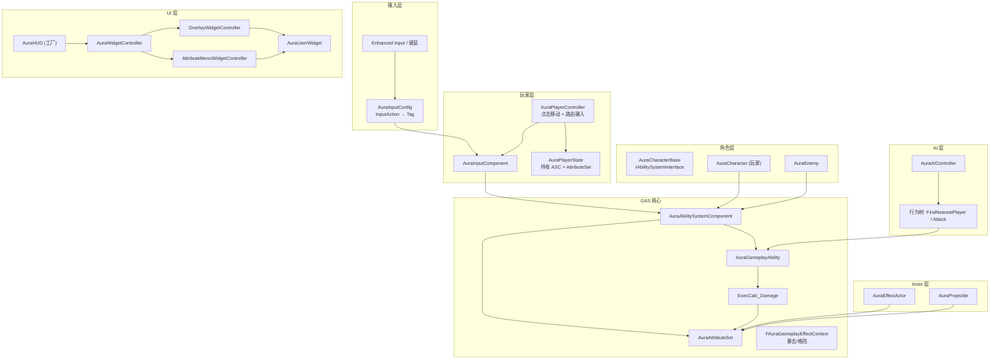
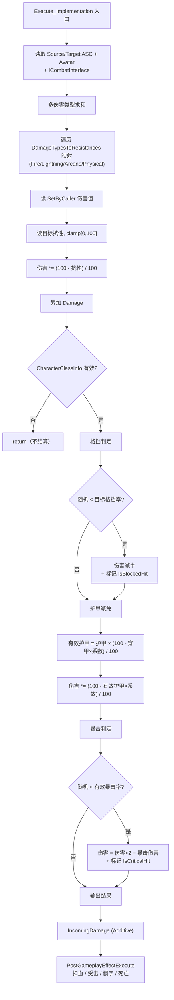
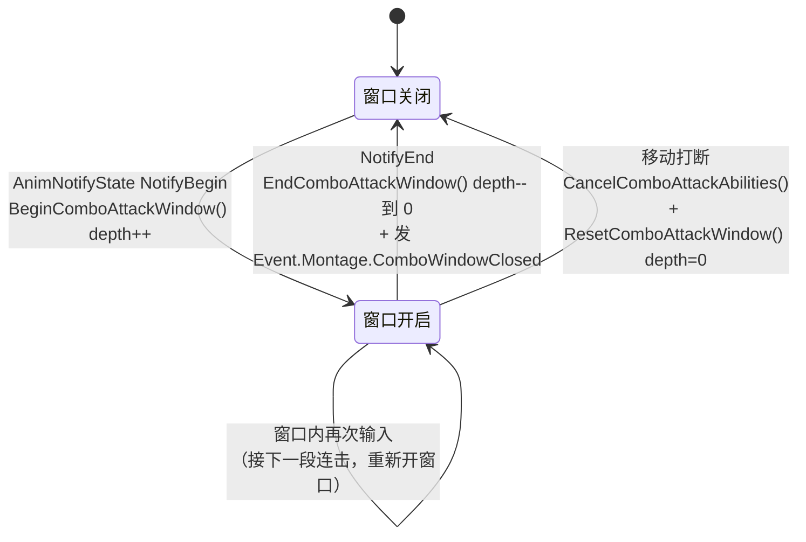
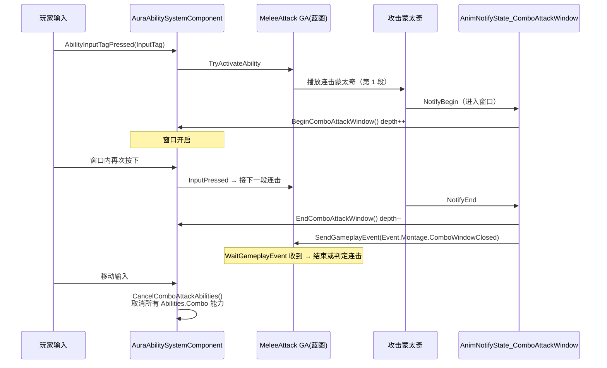
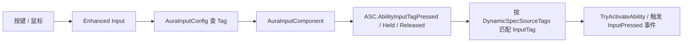
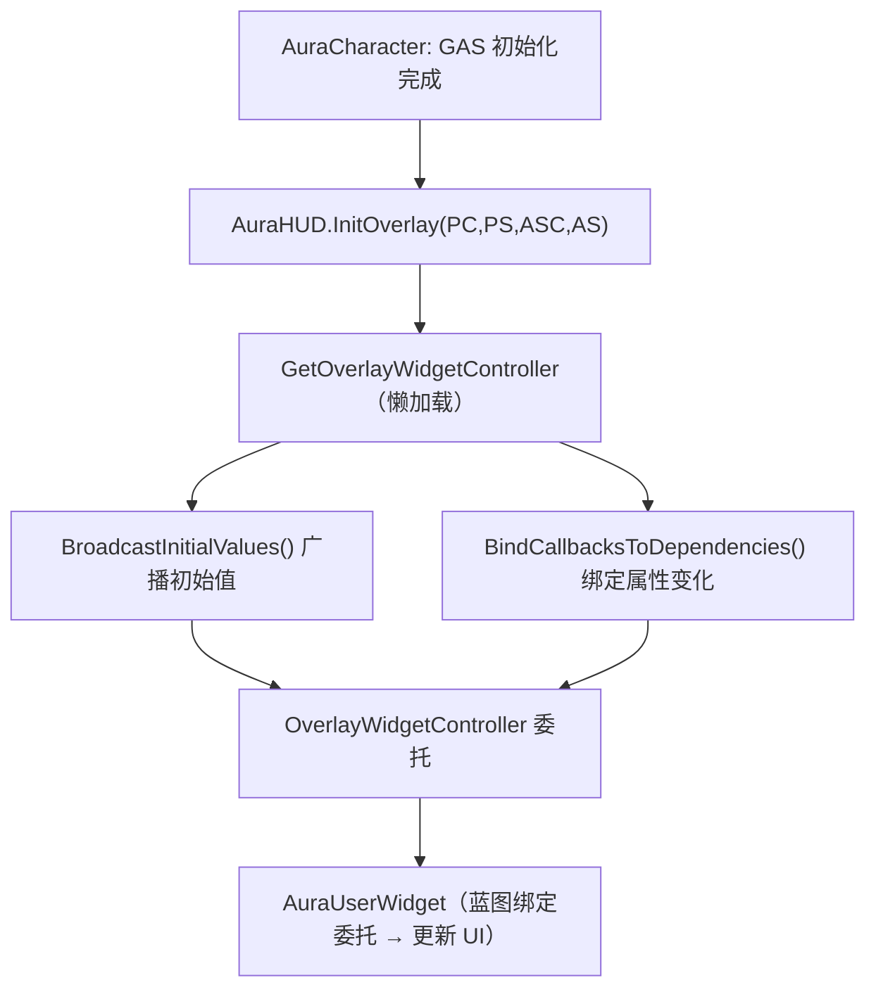

# Aura 项目架构文档

> 本文档用于帮助你**完整掌握** `Aura` 项目。它把项目拆成：目录结构、代码模块地图、四条核心数据流、关键流程图（Mermaid）、以及一份分阶段的掌握路线。
>
> 配套文档：
> - 笔记主线索引：[`NoteBook/README.md`](NoteBook/README.md)
> - 代码审查报告：[`CodeReview_Suggestions/`](CodeReview_Suggestions/)
> - 图表可单独查看（GitHub/VS Code 等支持 Mermaid 的预览器可渲染）。

---

## 1. 项目是什么

- **引擎**：Unreal Engine 5.6
- **类型**：C++ 单模块项目，基于 **GAS（Gameplay Ability System）** 的俯视角 ARPG/RPG
- **来源**：Stephen Ulibarri《UE5 Gameplay Ability System – Top-Down RPG》教程项目（"Aura"），并在其上做了**自定义扩展**
- **自定义扩展（超出教程的部分，也是理解的难点）**：
  1. **近战三连段攻击 + 连击窗口系统**（`UAuraMeleeAttack`、ASC 里的 `ComboAttackWindowDepth` 状态机、`UAuraAnimNotifyState_ComboAttackWindow`）
  2. **敌人 AI 的主动攻击行为树任务**（`UBTTask_Attack`）
  3. **角色换皮为 Phoebe**（`UE_Import/Phoebe_Aura`）

### 模块依赖（`Source/Aura/Aura.Build.cs`）

| 依赖类型 | 模块 |
|---|---|
| Public | `Core`, `CoreUObject`, `Engine`, `InputCore`, `EnhancedInput`, `GameplayAbilities`, `UMG` |
| Private | `GameplayTags`, `GameplayTasks`, `NavigationSystem`, `MotionWarping`, `Niagara`, `AIModule` |

### 启用插件（`Aura.uproject`）

`GameplayAbilities`、`MotionWarping`、`ModelingToolsEditorMode`（编辑器）、`RMFixTool`

---

## 2. 目录结构：哪些重要，哪些可忽略

| 目录 | 性质 | 需要关注吗 |
|---|---|---|
| `Source/` | C++ 源码（**大脑**，81 个文件） | ✅ 核心 |
| `Content/` | 资产/蓝图/GE/GA/数据表（**身体**） | ✅ 核心（在编辑器里看） |
| `Config/` | 项目配置，含 `DefaultGameplayTags.ini` | ✅ 要看 |
| `Aura.uproject` / `Aura.sln` | 项目入口 / VS 解决方案 | ✅ 小 |
| `NoteBook/` | 27 篇中文学习笔记 | ✅ 你的宝藏 |
| `CodeReview_Suggestions/` | 2 份 EnemyHit 漏洞报告 | ⚠️ 建议读 |
| `UE_Import/` `Asset/` `Data/` `Scripts/` | 原始素材 / 导入源 | 📎 参考 |
| `Binaries/` `Intermediate/` `DerivedDataCache/` `Saved/` | 编译/缓存产物 | ❌ 可忽略 |
| `.vs/` `.idea/` `.vsconfig` | IDE 缓存 | ❌ 可忽略 |

**结论**：要"掌握"的核心 = `Source/` 的 81 个 C++ 文件（逻辑）+ `Content/` 里对应的资产（数据）。

---

## 3. 代码架构地图（按模块）

`Source/Aura` 按职责分目录，这是理解整个项目的第一张地图。

### 3.1 Gameplay Tags（全局"脊髓"）

| 文件 | 职责 |
|---|---|
| `AuraGameplayTags.h/.cpp` | 单例，集中定义所有原生 Tag：属性、伤害类型、输入（LMB/RMB/1-4）、技能（Attack/Combo）、Effects.HitReact 等。**整个项目靠 Tag 串起来**。 |

Tag 层级（`Config/DefaultGameplayTags.ini` + 原生 Tag）：
- `Attributes.Primary.*`（力/智/韧/活）、`Attributes.Secondary.*`（护甲/暴击/格挡…）、`Attributes.Resistance.*`（火/电/奥/物理）
- `Damage.*`（火/电/奥/物理）、`InputTag.*`（LMB/RMB/1-4）
- `Abilities.Attack` / `Abilities.Combo`、`Effects.HitReact`、`Event.Montage.ComboWindowClosed`

### 3.2 AbilitySystem（GAS 核心，最重）

| 类 | 职责 |
|---|---|
| `AuraAbilitySystemComponent` | 自定义 ASC：把输入路由到技能、广播 GE 资产标签到客户端、**连击窗口状态机** |
| `AuraAttributeSet` | 所有属性（主/次/抗性/生命法力/`IncomingDamage` 元属性），含 `PreAttributeChange`/`PostGameplayEffectExecute` |
| `ExecCalc_Damage` | 伤害执行计算：多伤害类型求和 → 格挡 → 护甲 → 暴击 → 输出 `IncomingDamage` |
| `MMC_MaxHealth` / `MMC_MaxMana` | 由主属性推导最大生命/法力的 MMC |
| `AuraAbilityTypes` | 自定义 `FAuraGameplayEffectContext`，携带"是否暴击/格挡" |
| `AuraAbilitySystemGlobals` | 让 GAS 使用自定义 EffectContext |
| `AuraAbilitySystemLibrary` | 静态工具：取 WidgetController、初始化默认属性/技能、读写暴击/格挡标志 |
| `AuraAssetManager` | 启动时初始化原生 Gameplay Tags |
| `Ability/AuraGameplayAbility` | 技能基类（含 `StartupInputTag`） |
| `Ability/AuraDamageGameplayAbility` | 伤害技能基类（`DamageEffectClass` + `DamageTypes` 映射） |
| `Ability/AuraProjectileSpell` | 投射物技能（生成 `AAuraProjectile`） |
| `Ability/AuraMeleeAttack` | 近战技能（逻辑主要在蓝图） |
| `Data/CharacterClassInfo` | 职业数据资产（Elementalist/Warrior/Ranger + 伤害系数曲线表） |
| `Data/AttributeInfo` | 属性元数据（Tag → 名称/描述/图标） |

### 3.3 Character（角色继承链）

| 类 | 职责 |
|---|---|
| `AuraCharacterBase`（抽象） | **GAS 挂载点**：持有 ASC + AttributeSet，实现 `IAbilitySystemInterface` + `ICombatInterface`，含武器插槽、溶解、死亡 |
| `AuraCharacter` | 玩家角色 |
| `AuraEnemy` | 敌人角色 |

### 3.4 Player / Input

| 类 | 职责 |
|---|---|
| `AuraPlayerController` | 点击移动、鼠标高亮检测、路由输入到技能 |
| `AuraPlayerState` | 服务器端持有 ASC/属性（供 UI 复用） |
| `AuraInputConfig` | 数据资产：`InputAction → GameplayTag` 映射 |
| `AuraInputComponent` | 把按键绑定转发成 `AbilityInputTagPressed/Held/Released` |

### 3.5 Interaction（接口解耦）

| 接口 | 职责 |
|---|---|
| `ICombatInterface` | 战斗通用：武器插槽位置、受击蒙太奇、是否攻击中、玩家等级 |
| `IEnemyInterface` | 鼠标悬停高亮 |

### 3.6 Actor

| 类 | 职责 |
|---|---|
| `AuraEffectActor` | 地图效果区域（重叠时应用/移除 GE） |
| `AuraProjectile` | 投射物（碰撞检测 + 命中应用伤害 GE） |

### 3.7 AI

| 类 | 职责 |
|---|---|
| `AuraAIController` | 敌人 AI 控制器 |
| `BTService_FindNearestPlayer` | 行为树服务：找最近玩家 |
| `BTTask_Attack` | 行为树任务：触发近战攻击（`UAuraMeleeAttack`） |

### 3.8 UI（三层结构，重点）

| 类 | 职责 |
|---|---|
| `AuraHUD` | **工厂**：按需创建 WidgetController |
| `WidgetController/AuraWidgetController` | 基类：`BroadcastInitialValues` + `BindCallbacksToDependencies` |
| `WidgetController/OverlayWidgetController` | 血/蓝条 + 消息广播 |
| `WidgetController/AttributeMenuWidgetController` | 属性面板 |
| `Widget/AuraUserWidget` | Widget 与 Controller 的连接点 |
| `Widget/DamageTextComponent` | 伤害飘字 |

---

## 4. 四条核心数据流

### 4.1 启动流（初始化）

```
GameMode(持有 CharacterClassInfo)
  → CharacterBase.BeginPlay
    → InitAbilityActorInfo()
      → 玩家: AuraCharacter → PlayerState 的 ASC
      → 敌人: AuraEnemy → 自身 ASC
    → InitializeDefaultAttributes()（应用初始 GE）
    → AddCharacterAbilities()（授予启动技能）
```

### 4.2 属性流

```
GameplayEffect 应用
  → AttributeSet 数值变化
  → PreAttributeChange（钳制） / PostGameplayEffectExecute（结算 + 受击 + 死亡）
  → ExecCalc_Damage（计算）
  → OnRep_* 复制 + 委托广播
  → WidgetController（Broadcast / BindCallbacks）
  → Widget 更新
```

### 4.3 输入流

```
按键 → Enhanced Input
  → AuraInputConfig（InputAction → Tag）
  → AuraInputComponent
  → ASC.AbilityInputTagPressed/Held/Released
  → 激活对应 GA（按 DynamicSpecSourceTags 匹配 InputTag）
```

### 4.4 伤害流

```
GA 命中（投射物 / 近战）
  → EffectContext 标记（暴击 / 格挡）
  → ExecCalc_Damage（读抗性/护甲/暴击系数表）
  → IncomingDamage 元属性
  → PostGameplayEffectExecute 扣血 + 受击 + 飘字
```

---

## 5. 关键流程图（Mermaid）

### 5.1 整体架构（分层）



### 5.2 伤害计算流程（`ExecCalc_Damage`）

> 结算顺序：**多伤害类型求和 → 格挡 → 护甲 → 暴击 → 输出**。系数来自 `CharacterClassInfo.DamageCalculationCoefficients`（`ArmorPenetration` / `EffectiveArmor` / `CriticalHitResistance` 三条曲线，按等级取值）。



### 5.3 连击窗口状态机（自定义扩展）

> `ComboAttackWindowDepth` 用**深度计数**而非 bool，是为了处理连击段切换时新旧通知窗口的重叠（旧 NotifyEnd 在下一段 NotifyBegin 之后才触发的情况）。



### 5.4 连击攻击时序



### 5.5 输入 → 技能流程



### 5.6 UI 数据流（三层）



---

## 6. 分阶段掌握路线

| 阶段 | 内容 | 关键文件 | 目标 |
|---|---|---|---|
| 0 | 能跑起来 | 编译 + PIE | 建立直觉 |
| 1 | 读骨架 | `AuraGameplayTags` → `AuraCharacterBase` → `AuraAttributeSet` → `AuraHUD`/`AuraWidgetController` | 认识 Tag、GAS 挂载、UI 三层 |
| 2 | 追四条数据流 | 用断点追 4.1–4.4 | 打通链路 |
| 3 | GAS 概念逐个击破 | GE/Tag、GA/InputTag、ExecCalc/MMC、EffectContext/复制、DataAsset | 掌握 GAS |
| 4 | 啃自定义连段 | `AuraMeleeAttack`、`AuraAnimNotifyState_ComboAttackWindow`、ASC 窗口状态机 | 理解扩展 |
| 5 | 反向验证 | 改参数看变化 + 读 CodeReview 报告 | 巩固 |

---

## 7. 相关文档

- **笔记主线索引**（27 篇笔记按架构层次整理）：[`NoteBook/README.md`](NoteBook/README.md)
- **代码审查报告**（EnemyHit 漏洞）：[`CodeReview_Suggestions/01_EnemyHit_Vulnerability_Report.md`](CodeReview_Suggestions/01_EnemyHit_Vulnerability_Report.md)、[`02_EnemyHit_Fix_Suggestions.md`](CodeReview_Suggestions/02_EnemyHit_Fix_Suggestions.md)
